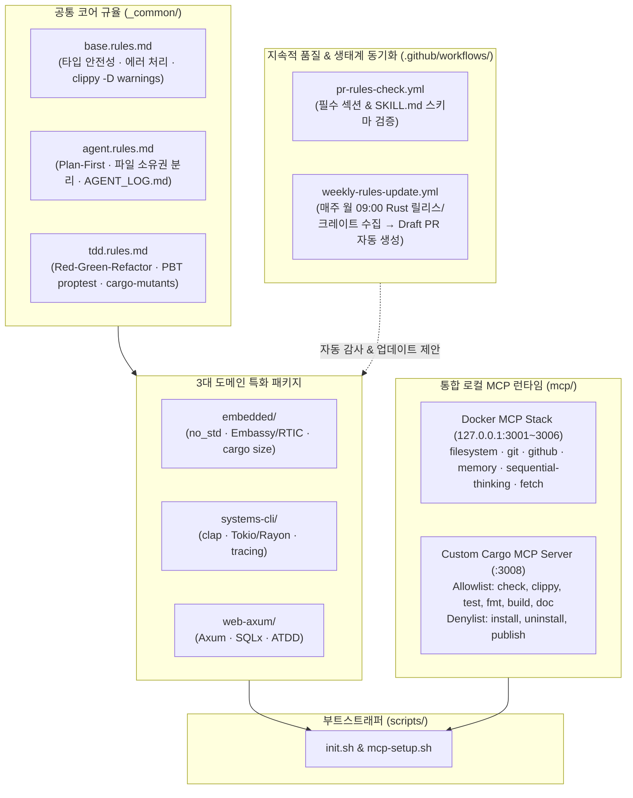
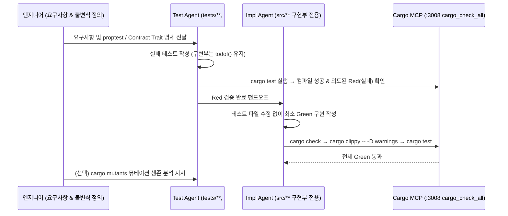

# 🦀 rust-ai-rules-template — 도메인 특화 Rust AI 코딩 규칙 · TDD 멀티에이전트 · MCP 스택 템플릿

[](https://www.rust-lang.org)
[](./scripts/init.sh)
[](#22-5대-ai-플랫폼-무간섭-공존-매핑)
[](./.github/workflows/weekly-rules-update.yml)
[](#5-라이선스)

> **임베디드(`no_std` / `Embassy` / `RTIC`), 시스템 CLI·데몬(`Tokio` / `Rayon`), 백엔드 웹(`Axum` / `SQLx`) 3대 Rust 도메인에 맞춰 설계된 멀티 플랫폼 AI 에이전트 규칙·지연 로딩 스킬(`SKILL.md`)·TDD 서브에이전트 격리 규율·Docker MCP 서버 스택 템플릿입니다.**

---

## 1. Why — 배경 및 해결하려는 문제

범용 LLM 코딩 에이전트로 Rust 프로젝트를 작성할 때 도메인별 제약 조건이 명문화되어 있지 않으면 다음과 같은 치명적 결함이 반복됩니다.

1. **도메인 불변식 위반 (`no_std` 힙 할당·패닉 유발)**: MCU 펌웨어(`embedded`) 코드에서 습관적으로 `Vec`/`String`, `println!`, 무검증 `unwrap()`을 생성하거나 블로킹 루프로 `Embassy` 비동기 실행기를 멈추게 만듭니다.
2. **멀티 에이전트 작업 시 테스트 무력화 (`TDD Cycle Collapse`)**: 하나의 에이전트가 테스트와 구현을 동시에 수정하면 실패하는 테스트 자체를 완화해 통과시키는 자기기만(Reward Hacking)이 발생합니다.
3. **도구별 설정 파편화 및 규칙 노후화**: `Claude Code`, `Cursor`, `Google Antigravity`, `Windsurf`, `GitHub Copilot`마다 규칙 파일 경로와 MCP 연결 포맷이 다르고, 빠르게 변하는 Rust 크레이트/보안 권고를 수동으로 추적하기 어렵습니다.

본 저장소는 **① 도메인별 컴파일러·메모리·동시성 제약 명문화, ② 파일 소유권이 물리 분리된 AI-TDD 멀티에이전트 워크플로우, ③ 로컬호스트 격리형 Docker + Cargo 샌드박스 MCP 스택, ④ 주간 Rust 생태계 자동 분석 PR 파이프라인**을 단일 초기화 스크립트(`scripts/init.sh`)로 묶어 제공합니다.

---

## 2. What — 핵심 구성 요소

### 2.1 3대 타겟 Rust 엔지니어링 도메인

| 도메인 디렉토리 | 타겟 워크로드 | 핵심 크레이트 & 런타임 | 강제되는 엔지니어링 불변식 |
| :--- | :--- | :--- | :--- |
| **`embedded/`** | MCU 펌웨어, RTOS/비동기 임베디드, 하드웨어 드라이버 | `no_std`, `Embassy`, `RTIC`, `embedded-hal`, `defmt`, `cortex-m` | • 동적 힙 할당 금지 (`static` / 고정 크기 스택 버퍼만 허용)<br/>• `println!` 금지 → `defmt::info!/warn!/error!` 강제<br/>• 기능 전후 `cargo size` 바이너리 예산 검증 및 `memory.x` 대조<br/>• 페리페럴 초기화 `unwrap()` 시 리셋/안전 정지 복구 경로 필수 |
| **`systems-cli/`** | 고성능 CLI, OS 데몬, 네트워크/시스템 유틸리티 | `clap`, `Rayon`, `Tokio`, `tracing`, `thiserror` / `anyhow` | • Zero-copy 버퍼 처리 및 명시적 타임아웃/백프레셔 설계<br/>• 라이브러리(`thiserror`) vs 바이너리 경계(`anyhow`) 에러 타입 분리<br/>• 구조화 로깅(`tracing`) 및 종료 코드/시그널 핸들링 규율 |
| **`web-axum/`** | 고동시성 REST API, 비동기 백엔드 서비스 | `Axum`, `SQLx`, `Tokio`, `Tower`, `proptest` | • Router → Handler → Service → Repository 계층 분리<br/>• 컴파일 타임 쿼리 검증(`SQLx`) 및 인수 테스트(`spawn_test_app`) 우선 |

### 2.2 5대 AI 플랫폼 무간섭 공존 매핑

각 플랫폼은 고유 경로만 읽으므로 한 프로젝트에 동시에 배치해도 충돌하지 않습니다.

| 플랫폼 | 복사되는 파일 위치 | 동작 방식 |
| :--- | :--- | :--- |
| **Claude Code** | `<project>/CLAUDE.md` | 세션 시작 시 프로젝트 루트 자동 로드 |
| **Cursor / Windsurf** | `<project>/.cursorrules` | 에디터 워크스페이스 규칙 자동 감지 |
| **Google Antigravity** | `<project>/.gemini/GEMINI.md` | 프로젝트 상시 규칙 (Project Rules) |
| **Google Antigravity (Skills)** | `<project>/.agents/skills/{domain,test-agent}/SKILL.md` | 트리거 키워드(`embassy`, `DMA`, `proptest` 등) 감지 시 **Lazy-Load** |
| **GitHub Copilot** | `<project>/.github/copilot-instructions.md` | Copilot Chat / PR 리뷰 지침 자동 반영 |

---

## 3. How — 아키텍처 및 자동화 파이프라인

### 3.1 전체 시스템 구조 다이어그램



### 3.2 AI-TDD 멀티에이전트 파일 소유권 격리 사이클 (`_common/tdd.rules.md` & `test-agent`)

테스트 오염을 막기 위해 에이전트 간 수정 가능 경로를 엄격히 분리합니다.



### 3.3 커스텀 Cargo 샌드박스 MCP 서버 & Docker 공유 스택 (`mcp/`)
- **`mcp/servers/cargo/server.js`**: `@modelcontextprotocol/sdk`(SSE 트랜스포트, 기본 포트 `3008`)로 구현된 Rust 전용 MCP 서버입니다. 허용 명령(`check`, `clippy`, `test`, `fmt`, `build`, `doc`)만 실행하며 외부 패키지 설치·배포(`install`, `uninstall`, `publish`)는 원천 차단합니다. `cargo_check_all` 도구는 `cargo check` → `cargo clippy -- -D warnings` → `cargo test`를 순차 실행하고 첫 실패 지점에서 즉시 중단해 에이전트의 검증 루프를 단축합니다.
- **`mcp/docker-compose.yml`**: `filesystem(:3001)`, `git(:3002)`, `github(:3003)`, `memory(:3004)`, `sequential-thinking(:3005)`, `fetch(:3006)` 6종 MCP 컨테이너를 `127.0.0.1` 로컬 루프백에만 안전하게 바인딩하여 모든 AI IDE가 단일 MCP 백엔드를 공유하게 합니다.

### 3.4 주간 Rust 생태계 자동 추적 파이프라인 (`.github/workflows/weekly-rules-update.yml`)
- 매주 월요일 09:00 UTC에 `fetch_rust_updates.py`가 최신 Rust 공식 릴리스·생태계 변경사항을 수집하고, `suggest_rule_updates.py`가 도메인 규칙 반영안을 생성해 Draft Pull Request로 자동 제출합니다.
- 모든 규칙 수정 PR은 `pr-rules-check.yml`을 통해 `## Agentic Workflow`, `AGENT_LOG`, `cargo clippy` 필수 조항과 모든 `SKILL.md`의 `name:` / `triggers:` / `Verification Checklist` 포함 여부를 자동 검사받습니다.

### 3.5 디렉토리 구조

```text
rust-ai-rules-template/
├── _common/
│   ├── base.rules.md                  # 공통 Rust 코딩 표준 (타입·에러·린트)
│   ├── agent.rules.md                 # 멀티에이전트 계획·소유권·AGENT_LOG 규율
│   └── tdd.rules.md                   # AI-TDD 3단계, proptest, Contract-First, cargo-mutants 가이드
├── embedded/                          # 임베디드 펌웨어 도메인 (no_std, Embassy, RTIC, defmt)
│   ├── CLAUDE.md / .cursorrules / .gemini/GEMINI.md / .github/copilot-instructions.md
│   └── .agents/skills/{rust-embedded,test-agent}/SKILL.md
├── systems-cli/                       # 시스템 프로그래밍 & CLI 도메인 (clap, Tokio, Rayon)
│   ├── CLAUDE.md / .cursorrules / .gemini/GEMINI.md / .github/copilot-instructions.md
│   └── .agents/skills/{rust-systems-cli,test-agent}/SKILL.md
├── web-axum/                          # 비동기 웹 백엔드 도메인 (Axum, SQLx, Tokio)
│   ├── CLAUDE.md / .cursorrules / .gemini/GEMINI.md / .github/copilot-instructions.md
│   └── .agents/skills/{rust-web-axum,test-agent}/SKILL.md
├── mcp/
│   ├── docker-compose.yml             # 6종 공유 MCP 서버 스택 (127.0.0.1:3001~3006)
│   ├── .env.example                   # GITHUB_TOKEN 및 PROJECTS_ROOT 환경변수 템플릿
│   ├── configs/                       # antigravity, claude-code, cursor, windsurf 연결 설정
│   └── servers/cargo/                 # 허용 명령 화이트리스트 기반 Cargo MCP 서버 (Node.js SSE)
├── scripts/
│   ├── init.sh                        # 도메인 규칙 + Skills + (선택) MCP 설정 원클릭 배포 스크립트
│   └── mcp-setup.sh                   # 플랫폼별 MCP 설정 파일 복사기
└── .github/
    ├── scripts/{fetch_rust_updates.py,suggest_rule_updates.py}
    └── workflows/{pr-rules-check.yml,weekly-rules-update.yml}
```

---

## 4. Quick Start — 로컬 적용 및 실행 가이드

### 4.1 새 Rust 프로젝트에 도메인 규칙 즉시 적용 (`init.sh`)

```bash
git clone https://github.com/tejo1990/rust-ai-rules-template.git
cd rust-ai-rules-template
chmod +x scripts/init.sh scripts/mcp-setup.sh

# 1) 임베디드 펌웨어 프로젝트에 규칙 + Skills 적용
./scripts/init.sh embedded ~/projects/my-firmware

# 2) 시스템 CLI 프로젝트에 규칙 + Skills 적용
./scripts/init.sh systems-cli ~/projects/my-daemon

# 3) Axum 웹 프로젝트에 규칙 + 모든 플랫폼 MCP 설정까지 한 번에 적용 ('yes' 인자)
./scripts/init.sh web-axum ~/projects/my-api yes

# 에이전트 작업 기록 파일 초기화
touch ~/projects/my-firmware/AGENT_LOG.md
```

*(Windows PowerShell에서 수동 복사할 경우)*:
```powershell
$target = "C:\Projects\my-firmware"
Copy-Item "embedded\CLAUDE.md", "embedded\.cursorrules" -Destination $target
Copy-Item "embedded\.gemini", "embedded\.agents", "embedded\.github" -Destination $target -Recurse -Force
```

### 4.2 Docker 공유 MCP 스택 및 Cargo MCP 서버 실행 (선택)

```bash
# 1. 환경변수 파일 생성 및 PROJECTS_ROOT / GITHUB_TOKEN 입력
cp mcp/.env.example mcp/.env

# 2. 로컬호스트(127.0.0.1:3001~3006) MCP 컨테이너 스택 기동
docker compose -f mcp/docker-compose.yml up -d
docker compose -f mcp/docker-compose.yml ps

# 3. 커스텀 Cargo 샌드박스 MCP 서버 단독 실행 (Node.js 20+)
cd mcp/servers/cargo
npm install
WORKSPACE=/path/to/your/rust-crate MCP_PORT=3008 node server.js
```

---

## 5. 라이선스

MIT License
